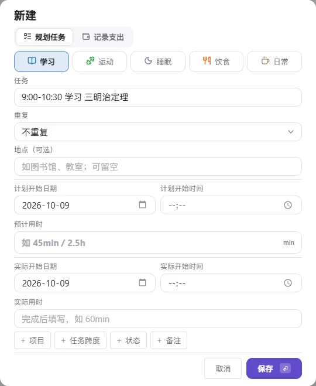
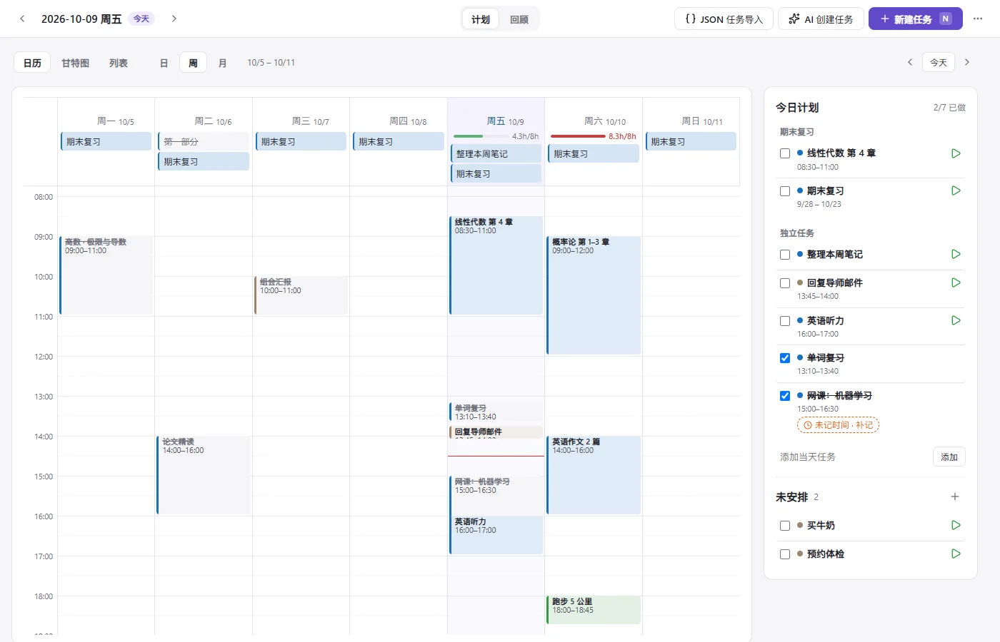
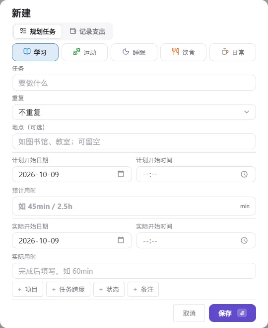
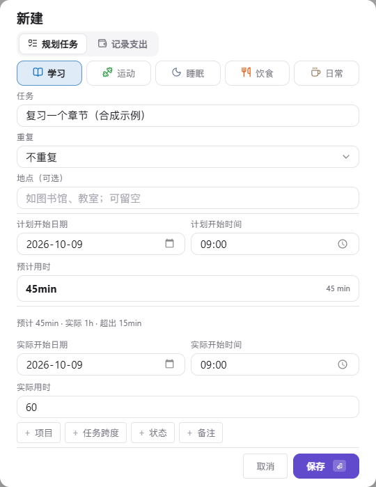

<p align="center">
  
</p>

<p align="center">
  <b>Lubi</b> —— 在 Obsidian 里践行柳比歇夫时间记录法：<b>记一条、看一眼、排一下</b>。<br>
  <sub>A Lyubishchev-style time tracker, review dashboard and weekly planner for Obsidian. Records stay in Markdown; tasks use JSON.</sub>
</p>

<p align="center">
  
  
  
  <a href="LICENSE"></a>
</p>

---

这个仓库是一个**开箱即用的 Obsidian 仓库（vault）**，核心是自研插件 **Lubi**：

- **计划**：日历 / 甘特图 / 列表均支持日 / 周 / 月；默认打开今天的列表日视图，左侧先看「需我处理」和当天任务，右侧集中后台任务、本人用时与未安排；日历时间轴、分类分布和全部排期视图仍可切换；
- **回顾**：按周 / 月 / 年汇总，查看分类占比、事项 Top 5、支出和全年覆盖热力图。
- **名称复用**：规划任务和记录时间可按分类选择历史名称，输入文字实时筛选；列表最多露出 5 行，其余滚动查看，最近使用顺序重启后保留。

> [!NOTE]
> 下方旧截图是 v1.7.0 合成演示，不含真实个人记录；当前未发布工作区已接入 MONO 黑白设计及新的记录入口，布局以本节文字为准。生产包模拟与 Chromium 验证不等于真实 Obsidian 或移动端人工验收。

## 版本

- **已发布：1.7.1**（标签 `1.7.1`）。
- **开发中：1.8.0**（`main` 分支当前代码，未发布，没有标签和 Release）。本 README 按 1.8.0 描述，标「未发布」的小节在 1.7.1 中没有。主要变化：MONO 黑白界面与默认列表·日、统一的「记用时」入口、轻量任务表单、工作复盘与整理、AI Key 可存入 Obsidian 钥匙串、最低 Obsidian 版本提高到 1.13.7。完整列表见 [更新日志](CHANGELOG.md) 的 1.8.0。

任务数据初始化为空，个人日记和 AI 设置不随仓库分发。GitHub Release 独立发布，不会因代码推送自动生成。维护入口见 [文档索引](docs/README.md)。

## MONO 黑白工作流（未发布）

**1.8 新增**：更多菜单 →「工作复盘与整理」，或命令面板搜索投入与成果、周复盘行动、整理逾期任务、实时计时、隔离数据恢复。详见 [新增功能与验证边界](docs/mcp-lubi-productivity-1.8.md)。

- 浅／深主题共享命名颜色、字号、间距与控件 Tokens，组件不再借分类色表达完成或本人投入；分类数据及设置保留，不新增时间分类。
- 「需我处理」跨日期显示，切换查看日期不让待审核结果消失；左侧当天任务保留项目分组、拖拽排序、勾选和快速添加，右侧依次为后台任务、我的用时、未安排。
- 完成／验收与记时是两件事；撤销完成保留历史用时。重复任务的验收发生日与真实投入日可以不同。
- 未安排任务不强制填日期或预计；Agent 墙钟仅为手动标注，不计入人的实际用时，不自动控制 Agent 或采集其他电脑。

## 目录

- [界面一览](#界面一览)
- [功能](#功能)
- [项目与任务](#项目与任务)
- [界面与提示](#界面与提示)
- [预计与实际](#预计与实际)
- [AI 与隐私](#ai-与隐私)
- [安装](#安装)
- [快速上手](#快速上手)
- [数据格式](#数据格式)
- [开发](#开发)
- [仓库结构](#仓库结构)
- [致谢与许可](#致谢与许可)

## 界面一览

### 日历日视图 · 时间轴（切换入口）

<picture>
  <source media="(prefers-color-scheme: dark)" srcset="docs/images/today-dark.webp">
  
</picture>

日历日视图默认显示今天，也可切换日期查看其他天：左边是当天的时间轴，拖动色块改时间，拉边缘改时长，在左侧记录区空白处拖出新记录；右侧计划列显示时，在其空白处拖选默认新建计划，日期、开始时间和预计用时自动带入；并行的事情（比如学习时接了个电话）会自动分栏。定了开始时间的任务画在时间轴右侧的虚线「计划」列，点击打开规划任务编辑；实际记录使用任务清单的 ▶ 按钮。右边的分类分布在顶部直接显示，当天计划在下方独立卡片中展示已做数量和进度条，默认展开的下拉清单按开始时间列出当天全部任务，未定时任务放在最后；空白时段默认展开，可点击收起。拖选的蓝色计划区域遮住区域内的当前时间红线，区域外红线和左侧时间标签仍保留。记录投入与实际覆盖等摘要放在日历日视图切换栏的日期后面，不再独占一行；侧栏不会因滚动条出现或消失而左右跳动。

| 补记空白 | 一行快速记录 |
| :---: | :---: |
|  |  |
| 两条记录之间空出 ≥ 30 分钟时，悬停即可「记这段」 | 通过快速记录入口输入 `9:00-10:30 学习 三明治定理`，保存时识别时间、分类和标题 |

### 回顾页 · 周 / 月 / 年

<picture>
  <source media="(prefers-color-scheme: dark)" srcset="docs/images/review-week-dark.webp">
  
</picture>

回顾页右上角仅保留更多菜单，不显示新建任务按钮；创建任务请回计划页或使用原快捷键。KPI 卡片只在两期都有足够记录时才显示环比，避免「少记一天就像效率暴跌」的误导；柱状图可切换为表格，睡眠用斜纹淡化，不喧宾夺主。


### 计划页 · 周日程

<picture>
  <source media="(prefers-color-scheme: dark)" srcset="docs/images/tasks-week-dark.webp">
  
</picture>

周日程显示所选日期所在的自然周（周一至周日），内部左右箭头每次翻一周，「今天」回到当前日期所在周。把任务拖到时间格里即可排期（15 分钟吸附）；每天顶部的负载条对比「预计时长 / 每日可用时长」，≥ 90% 变橙、超过 100% 变红，提醒你别把一天排爆。

### 窄栏与快捷键

| 窄栏（侧边栏 / 分屏） | 快捷键（面板内按 `?`） |
| :---: | :---: |
|  |  |

## 功能

**每日**
- 时间轴拖拽：移动、改时长；左侧空白处拖出记录，右侧计划列空白处拖出计划。悬停和选区限制在对应区域，并行记录自动分栏
- 一行快速记录：`9:00-10:30 学习 标题`、`30min 跑步`、`1h30m 看书`、`14:00 午饭`（需补填实际用时）等写法支持快速录入
- 空白补记、「接上一条」一键填入开始时间、`Alt+1…9` 切换分类
- 支出记录（金额 + 类别），与时间记录同一条时间线
- 关联任务记录保存预计用时快照，记录窗口和时间轴详情显示预计 / 本条实际 / 偏差；旧记录不补算
- 日历日视图计划块可上下拖动改开始时间、拉两端改预计时长；5 分钟吸附，Shift 精确到分钟，Esc 取消，修改可撤销，且不会自动生成实际记录
- 并行时长单独统计；跨过当天 24:00 的异常记录标记为「待校对」，不参与环比，并提供一键校对入口
- 计划列：当天定了时间的任务以虚线块叠在时间轴旁，点击编辑规划任务；过了计划时间仍未记录的计划会标橙
- 勾选完成只修改任务状态，不自动生成或删除实际记录，不补填未安排任务的计划日期。明确有开始时间及预计用时时，可手动「按计划补记」一条待确认记录；补记及撤销不改变完成状态。没有明确计划不猜测 30 分钟或开始时间。
- 右栏「空白时段」：列出最长的几段空白，点击定位或直接补记

**回顾**
- 周 / 月 / 年切换，KPI：记录总时长、有记录的天数、日均、覆盖率、支出
- 堆叠柱状图 ⇄ 表格，平均线；点击柱子打开当天（年视图下钻到月）
- 按分类、事项 Top 5、支出明细，全年覆盖热力图

**计划**
- 今日待办 / 未安排清单，保留父子任务分组与起止日期；不再单独展示项目面板；未安排任务可直接拖到上方当天清单，安排为当天全天任务（可撤销）；清单支持同一项目分组内拖拽排序，顺序自动保存且不改排期
- 日历 / 甘特图 / 列表三种展示方式，共用日 / 周 / 月范围与日期导航。默认今天的列表·日，周视图为周一至周日；所有展示方式和周期均为主内容在左、已有任务侧栏在右；右侧统一为日历·日的 300px 宽度，面板宽度不超过 900px 时侧栏统一置于主内容下方并铺满可用宽度；切换方式不重置范围或日期，选择仅在本次面板打开期间保留。日历日 / 周固定显示 00:00–24:00，月为标准月历；空数据也保留坐标和日期。日历·日时间轴在左、摘要卡在右，呈现实际记录与计划对照、分类分布环形图及计划进度卡，清单默认展开、按时间排序，未安排任务入口保留。
- 重复任务：每天 / 每周（选周几）/ 每月（选几号）；可跳过某一次，不改变重复规则
- 「记用时」打开本人实际记录窗口：关联任务作为只读上下文，计划字段默认折叠，实际用时优先；默认只保存用时，只有勾选「这次也标记完成」后保存才同时完成（Agent 任务为验收）。预计不预填为实际，重复任务只完成指定发生日；实际日期可另选，切换日期不会带入原日用时，取消、写入失败及单纯记录不自动完成。
- 可选 AI 创建：自然语言生成任务 / 后续任务草稿，逐项确认保存后才写入
- 日历日 / 周保留时间拖动、拉伸和空白选区创建；月历支持拖到其他日期，保留开始时间并整体移动已有跨度。甘特图日视图首行是 00:00–24:00 时间线，周 / 月按日期绘制任务跨度。列表按日期和开始时间排列，普通跨日任务只列一次，重复任务按发生日分别列出。
- 保留项目归属、规划编辑、拖动和撤销；周／月任务条可拉左右端调整日期范围；甘特图未完成条使用类别浅色，完成条使用同色实心填充，不添加勾号或删除线，取消完成恢复浅色。未定时 / 未填预计不伪造时长，日期或时间规划操作不修改实际记录。窄屏在图内横向滚动，任务名称固定。
- 每日负载条（没排计划的日子不显示）；从任务直接「记一条」，记录自动关联任务

**体验**
- 亮色 / 暗色主题自动跟随 Obsidian，文字对比度 ≥ 4.5:1
- 更多菜单 / 命令面板可「导出数据 JSON」，包含任务（预计、排期、重复、项目归属与完成状态）以及实际时间 / 支出记录（预计快照、自定义字段）。文件仅保存在 Vault 根目录，不包含插件设置或 AI 密钥；导出格式不是「JSON 任务导入」的追加格式，可在「工作复盘与整理 → 数据恢复」创建隔离恢复副本，不覆盖当前数据。任务仍存 JSON，实际记录仍存 Markdown，不因导出迁移。
- 每日和回顾摘要区分记录投入、实际覆盖和并行重叠
- 键盘优先：`N` 在各页打开统一任务表单；窗口只切换「规划任务 / 记录支出」，预计用于排期、实际用时用于本人投入；任务及支出编辑入口保留，独立记录优先填名称，关联任务记录优先填用时，计划字段默认折叠；`1/2` 依次切换计划 / 回顾，`←/→` 翻天、`T` 回到今天、`?` 查看全部快捷键
- 窄至 320px 的布局适配；首次打开有引导
- 删除实际记录保留规划任务及其完成状态，撤销仅恢复记录。旧版直接由记录生成的占位任务仍兼容成对删除，不把它当作独立规划任务。
- 拖拽改时间、删除记录、任务排期等操作可撤销；迁移旧版数据前自动备份

## 异步工作：本人投入与后台运行（未发布开发改版）

- 在任务表单的「＋ 执行方式」选择「本人」或「Agent 后台（手动标注）」。这是执行维度，不新增时间分类；旧任务默认本人，不自动迁移历史数据。
- Agent 任务行可标记「后台运行」和「结果待审核」。这些按钮只保存状态及标注用时，不会启动、停止或控制 Agent，也不请求 AI 接口。
- 「需我处理」跨日期汇总待审核结果，支持验收、返工、记录本人实际、添加后续动作；Agent 交付不等于人已验收。返工进入待重新启动，不自动计为下一轮运行。
- 「后台运行」可折叠查看多个同时推进的任务；标注用时与日记中的本人实际时间分开，不进入个人覆盖、重叠、分类或负载统计。预计值仍表示本人预计投入。
- 验收只改完成状态，不造实际时间或计划日期。未排期的一次性任务以标记完成日出现在当天清单，日期图表不伪造排期；后续动作是同项目的独立未安排任务。
- 重复任务逐次保存后台状态；今天补记昨天审核的本人用时，可以只完成昨天那次，其他发生日不受影响。

本轮是手动状态 MVP，尚无跨电脑自动采集或 Agent 调度；累计本人投入与总预算另见新增工具；真实 Obsidian 与移动端仍需人工验收。

## 项目与任务


项目名显示在任务列左侧的合并单元格中，横纵居中，不再独占顶部标题行；项目列与任务名称列在横向滚动时固定。短任务条放不下完整标签时不显示数字，单日条优先显示预计用时，未填写显示「未填预计」，跨日条才显示日期范围；详细日期、预计用时仍在悬停里，拖动和缩放时自动重新判断。当前时刻蓝线按当天实际时间定位，每 30 秒更新，覆盖任务条和文字但不拦截操作；未来日期包括周末保持普通底色，浅色主题下为白色。任务条不加左侧粗色装饰，左右边缘仍可伸缩并显示 ↔ 光标。没有独立项目侧栏、筛选按钮或新导航。日 / 周 / 月甘特图按项目分组，项目标题没有任务条或完成操作，未选项目的任务归入「独立任务」。范围列表按日期和时间排序，项目归属只显示一次；未安排清单按项目分组；日历只在任务详情中显示项目，不增加月格文字。回顾仍按活动分类统计。 列表的日 / 周 / 月视图右侧与甘特图一致：上方是当前选中日的任务清单（计数、项目分组、完成 / 记录操作及快速添加），下方是未安排；左侧范围列表继续保留。切换日期时右侧跟随更新，其他日期显示日期标题而不是固定“今天”。

项目是归属容器，不是待办，不占用计划时间、不勾选完成、不计入当天进度。新建任务点「＋ 项目」，可选现有项目或在原窗口输入名称、点击「创建项目」；项目立即保存，取消任务不会删除已创建的项目。任务可以不属于项目；同项目任务也各自保存时间、状态和实际记录，不做完成联动。日历日视图的当天计划按项目分组，项目标题只显示一次，任务行不重复归属文字；保留完成进度、折叠和原任务操作。列表主区域仍按日期范围列任务并以小字显示项目。

旧父子关系不会自动改写。先把任务文件备份到仓库外，再在「设置 → 数据维护 → 旧父任务转为项目」确认转换：顶层父项成为项目，旧层级展平；纯分组父项保留存档数据及 ID，不再出现在任务清单；有计划开始、预计、明确任务跨度、重复规则或历史实际记录的父项仍保留为任务。转换还会在配置的备份文件夹保存原文件，失败不发布新状态；历史 Markdown 记录不改。请勿在修改任务时同时转换。

## 界面与提示

任务清单的 ▶ 对齐任务名称的首行，长标题换行或带时间信息时仍保持对齐；日历、甘特图和列表共用同一规则，触屏保留较大的点击区域。

常见按钮和已显示的文字不再重复弹提示，包括未安排的 ＋、编辑 / 删除图标、展开收起与翻期箭头、分类和模型下拉等。任务 / 记录详情、图表数据、统计口径及有特殊后果的操作仍保留说明。▶ 提示「记录本人实际，可选择完成」，补记提示「按计划补记待确认记录，不改变完成状态」；关闭普通提示不影响操作、快捷键或读屏名称。详细使用见 [教学手册](Lubi%20教学手册.md#统一悬停提示)。

## 预计与实际

普通规划／编辑表单按「任务 → 重复 → 地点（可选）」、计划「开始日期 / 开始时间 → 预计用时」及实际「开始日期 / 开始时间 → 实际用时」分组，地点和预计区域下方以横线分隔。地点可留空，保存后可重新编辑或清空；旧任务无需补填。任务表单采用紧凑间距，不显示顶部分类色装饰条；正常桌面高度下默认表单无需滚动，小屏或展开额外字段时保留滚动以免裁掉按钮。实际信息直接显示；「记用时」专用入口将计划字段收进可选展开区，不改地点、重复和项目等编辑能力。项目、任务跨度、状态、备注和取消按钮各自带边框。新建统一使用任务表单，规划入口保留「规划任务 / 记录支出」，独立时间入口显示「记录时间 / 记录支出」。实际用时留空只保存计划；填写后可选择只记录实际，或明确完成并记录。未填写实际开始时标为待确认，不把计划开始当成真实发生时间。已有单条记录在同一任务表单中更新，不重复添加；多段或跨日记录继续在时间轴分别编辑。

周视图表头的星期文字在列内居中，右侧小字以 `月/日` 显示日期，两者底部对齐。当日仅将星期文字高亮为蓝色，保留列背景，不显示日期圆圈或装饰横线；窄屏在周日历内部横向滚动。





例如任务预计 45 分钟、实际记录 1 小时，窗口会显示「预计 45min · 实际 1h · 超出 15min」，并在 Markdown 分别保存 `[时长:: 1h]` 与 `[预计用时:: 45min]`。预计值取自当次任务并保存为历史快照，后续调整任务不会改写它。修改实际时长或结束时间，对比实时更新。

- 「记用时」不是实时计时器，实际用时需按本人真实投入填写；后台标注时间不替代它。
- 对比针对本条记录；同一任务分多条记录时，不要重复累加任务预计。累计任务投入与独立总预算可在「工作复盘与整理 → 投入与成果」查看。
- 无预计、无快照的旧记录不强行比较；自动生成的待确认记录核对后再比较。
- 计划日历的日 / 周网格固定显示 00:00–24:00；旧的日程显示时段设置已移除，兼容配置不再裁切规划网格。

## AI 与隐私

设置页的 AI 区域默认收起；模型只保留一个输入框，可手动填写或选择获取到的模型；获取成功、点击输入框或展开按钮时列出全部模型，仅主动输入文字时筛选，列表可滚动并跟随浅色 / 深色主题。获取模型不会更改当前选择。AI 是可选功能，默认接口为本地 Ollama 的兼容聊天地址；正常时间记录和任务管理不依赖 AI。可在设置的「JSON 任务导入」中复制系统提示词给外部 AI；拿到 JSON 后，点击顶部「AI 创建任务」左侧的「JSON 任务导入」，粘贴并导入，可选 `location` 字段保存地点（最多 200 字符）；未明确地点时不猜测、不继承。整批校验后一次新增，已有任务不覆盖，重复导入会新增重复任务。已有任务文件导入前会备份。点击计划页顶部「新建任务」左侧的「AI 创建任务」后，AI 草稿会显示识别出的地点，确认表单可修改或留空；后续任务仅使用自己明确的地点，不沿用主任务地点。解析请求只发送当前描述、分类名和日期上下文，不扫描或上传整个 Vault。模型列表与测试连接也需手动触发。

> [!WARNING]
> 云端接口会收到你主动提交的描述。API Key 不写入设置文件：可以只在本次会话临时填写，也可以在设置里从 Obsidian 钥匙串选择或新建 Key（设置文件只保存 Key 的名称，重启后无需重新填写；临时 Key 优先）；旧版明文 Key 在下一次保存设置时移除，历史备份／同步副本需自行清理。curl 验证 TLS 证书，凭据不放在进程参数；远程接口须 HTTPS，本机回环可 HTTP。真实在线服务兼容性仍需单独验证。

新增的 Git 忽略规则覆盖个人日记、AI 设置、工作区状态、导出和备份；已被 Git 跟踪的旧配置不会因忽略规则自动停止跟踪。提交时仍应只选择源码、测试、文档及明确的分发文件。

## 安装

> [!IMPORTANT]
> 本仓库为私有仓库，仅供自用：Lubi 不在社区插件市场上架，也没有公开的 Release。

**方式一：直接使用本仓库（需要仓库访问权限）**

```bash
git clone https://github.com/wilsoncslearn/obsidian_task_kanban.git
```

用 Obsidian「打开文件夹作为仓库」选中克隆下来的目录，在 *设置 → 第三方插件* 里关闭安全模式即可。Lubi 和常用插件都已配置好。

**方式二：只装 Lubi 到你自己的仓库**

1. 从本仓库的 `.obsidian/plugins/lubi/` 拷贝 `main.js`、`manifest.json`、`styles.css` 三个分发文件；
2. 放到你的仓库的 `.obsidian/plugins/lubi/` 目录下；
3. 重启 Obsidian，在 *设置 → 第三方插件* 中启用 **Lubi 柳比歇夫记录**。

> 需要 Obsidian ≥ 1.13.7。

### 更新插件

仓库保持私有时，GitHub 接口对未登录请求返回 404，「检查更新」会提示“找不到公开的正式版本”。这时在仓库目录执行 `git pull` 即可：三个分发文件随仓库一起更新，重启 Obsidian 后生效。下面的一键更新只在仓库公开、并且发布了带校验信息的 Release 时可用。

在 **设置 → Lubi → 插件更新** 点击「检查更新」。本地比正式 Release 新时不会降级；发现新版后，桌面本地 Vault 可点击「更新至…」并确认安装。附件必须包含三个分发文件及 GitHub SHA-256 校验信息；安装前校验插件 ID、版本和最低 Obsidian 版本，先备份再替换，异常时回滚。安装完成后**重启 Obsidian**生效，避免通过非公开接口强制卸载正在使用的插件。

只替换 `main.js`、`styles.css`、`manifest.json`，不改 `data.json`、任务或日记。旧文件保存在系统临时目录的 `Lubi-plugin-backups` 中，结果提示显示具体备份位置；需要长期保留时请自行另存。回滚未完成或存在 `.lubi-update` 残留时，请先关闭 Obsidian，从提示的备份恢复三个分发文件，并移除该暂存目录后再启动，不要删除整个插件目录。不要与其他更新工具同时安装 Lubi；自动备份不能替代个人数据的常规备份。

移动端、非本地文件系统或缺少校验信息的旧 Release 使用发布页手动下载。联网只在检查或确认更新后发生，访问公开 GitHub API 和该仓库的发布附件，不发送任务、日记或 AI 配置。旧于本版本的安装需要先手动升级一次才能获得更新按钮。

## 快速上手

1. 点左侧栏的沙漏图标，或命令面板执行 **Lubi: 打开面板**；顶部按「计划 → 回顾」排列。
2. 在「计划 → 日历 → 日」按 `N`（或右上角「新建任务」），填名称与实际用时即可保存记录；同时完成必须明确勾选；也可一行输入 `8:30-10:00 学习 线性代数`。
3. 在「计划」新建任务；点「记用时」默认只保存本人实际投入，或勾选同时完成后保存。只勾选完成不会生成时间记录。
4. 到「回顾」选择周 / 月 / 年，比较记录投入、实际覆盖和分类分布。

完整教程见仓库根目录的 **[Lubi 教学手册](Lubi%20教学手册.md)**（在 Obsidian 里打开体验最好）。

## 数据格式

Lubi 不使用数据库，所有数据都是普通文件，可以用任何编辑器查看、用 git 管理，也能被 Dataview 查询。

**日记**：`日记/YYYY-MM-DD.md`，Lubi 只读写其中的 `## 记录` 一节，其余内容原样保留。

```markdown
---
date: 2026-09-26
---

# 2026-09-26

## 记录
- 08:30–11:00 学习 · 线性代数 第 4 章 [时长:: 2.5h] [任务:: demo-la] [备注:: 完成 4.1–4.3]
- 09:30–10:00 日常 · 接电话 [时长:: 30min]
- 12:10 财务 · 午饭 [金额:: 28] [类别:: 餐饮]
```

- 时间记录：`开始–结束 分类 · 事项 [时长:: …]`，可选 `[任务:: id]`、`[备注:: …]`、`[预计用时:: 45min]`
- 预计用时保存任务当次的计划快照；记录窗口和时间轴详情可对比本条实际用时。历史记录不补算，任务后续修改不会改变快照；预计不参与实际时长统计，同一任务的多条记录不要重复累加预计。
- 支出记录：`时刻 财务 · 事项 [金额:: …] [类别:: …]`
- 默认分类：学习 / 运动 / 睡眠 / 饮食 / 日常 / 财务，可在设置里增删改色

**任务**：`任务/任务数据.json`（schema v14：任务、项目、排期、重复规则，以及可选 `location` 地点）。仓库模板的任务数组为空。清空该数组只清除任务 / 项目 / 重复规则，不删除日记中的实际记录或预计快照；操作前先备份，参见教学手册第 7 节。

日记文件夹、任务文件路径、每日可用时长等都可以在插件设置里修改。

**重新开始使用**：关闭 Obsidian，先把任务文件和日记备份到仓库外。只清空任务不会清空实际记录；完整初始化还需清除日记「记录」节中的时间 / 支出记录，以及本地设置的历史名称列表 `nameUses`。保留日记其他章节、分类和 AI 配置；不要把含密钥的设置文件作为空模板提交。具体步骤见教学手册第 7.5 节。

## 开发

插件源码在 `插件源码/lubi/`（TypeScript + esbuild，无运行时依赖）。

```bash
cd 插件源码/lubi
npm ci           # 按锁文件安装；Node/npm 版本以依赖 engines 为准
npm run dev      # 监听构建
npm run build    # 类型检查 + 压缩生产构建（保留类名），输出 main.js
npm test         # 核心逻辑 + 冒烟测试 + 布局回归
npm run check:dist   # 生产构建并核对 Vault 中的三个分发文件
npm run lint         # Obsidian 官方 lint 规则（目前只报告问题，不阻断提交）
```

- 优先在独立测试 Vault 验证；不要用个人日记做自动化测试。
- 本仓库是可直接打开的 Vault，已有 `.obsidian/plugins/lubi/` 分发文件随仓库跟踪；源码目录中的生成物仍忽略。发布前同步三个文件并核对哈希，之后在 Obsidian 禁用再启用 Lubi 或重启。
- Windows PowerShell 可设置 `$env:LUBI_OUT` 为测试插件目录后运行 `npm run build`；不提交具体本机路径。
- 生产包验证：先 `npm run build`，再在 PowerShell 设置 `$env:LUBI_TEST_PLUGIN="../../main.js"`（相对测试文件，也可写绝对路径），执行 `node --test "test/smoke/*.mjs"`，用实际生产包跑全部冒烟测试。
- 布局回归测试需要 Chrome / Edge，设置环境变量 `LUBI_BROWSER` 指向浏览器可执行文件，否则自动跳过；正式验证同时设置 `LUBI_REQUIRE_BROWSER=1`，避免把跳过当通过；
- README 与教学手册的截图由演示数据生成：`node test/helpers/preview-manual.mjs` 渲染静态预览页，再运行 `python scripts/screenshots.py` 截图（依赖 Playwright + Pillow，详见脚本开头）。

## 仓库结构

```text
.
├── AGENTS.md                 # 开发约定与数据 / 发布红线
├── CHANGELOG.md              # 当前版本变更与已知限制
├── Lubi 教学手册.md          # 使用教程（Obsidian 中打开）
├── 日记/                     # 每日记录（Lubi 自动创建）
├── 任务/任务数据.json         # 任务与项目
├── 附件/lubi手册/             # 教学手册配图
├── 插件源码/lubi/             # Lubi 插件源码
│   ├── src/core/             #   纯逻辑：记录解析、统计、任务、迁移
│   ├── src/ui/               #   视图：记录 / 回顾 / 任务 / 弹窗
│   ├── styles.css
│   └── test/                 #   测试、演示数据与预览
├── docs/                     # 设计与维护文档、README 配图
└── .obsidian/                # 仓库配置与已安装插件
    └── plugins/lubi/         #   Lubi 构建产物
```

## 致谢与许可

- 灵感来自苏联生物学家 **亚历山大·柳比歇夫** 坚持 56 年的时间统计法（《奇特的一生》）。
- 交互上借鉴了 Toggl、Timing、Sunsama、Amie 等优秀产品的做法（时间轴补记、负载提醒、自然语言快速添加）。
- `.obsidian/plugins/` 中的第三方插件（Dataview、Templater、QuickAdd、Kanban、Style Settings 等）版权归各自作者所有，遵循其各自的许可证，此处仅作为仓库配置的一部分分发。

Lubi 插件源码与本仓库文档以 [MIT License](LICENSE) 发布。
